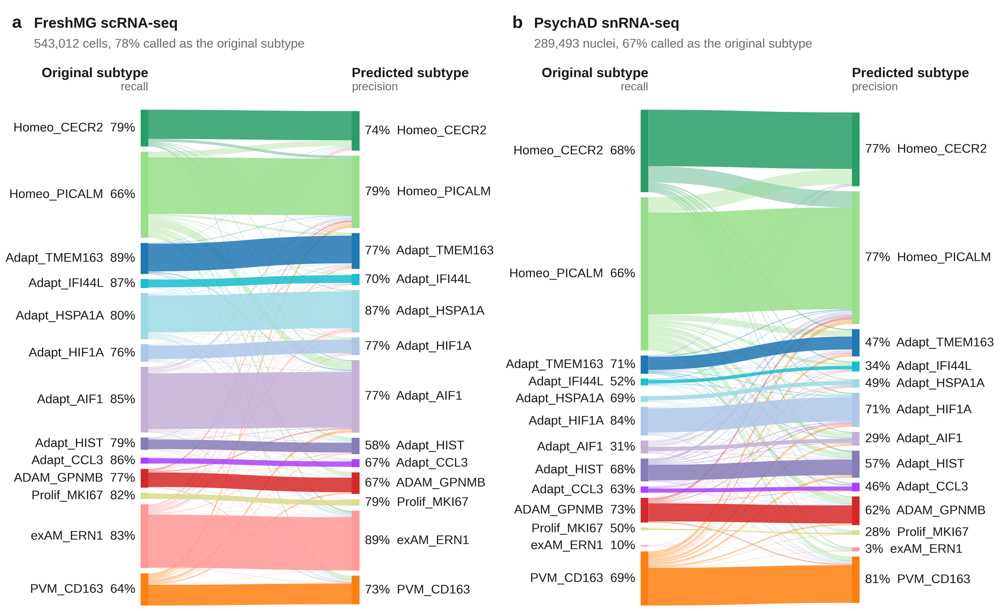
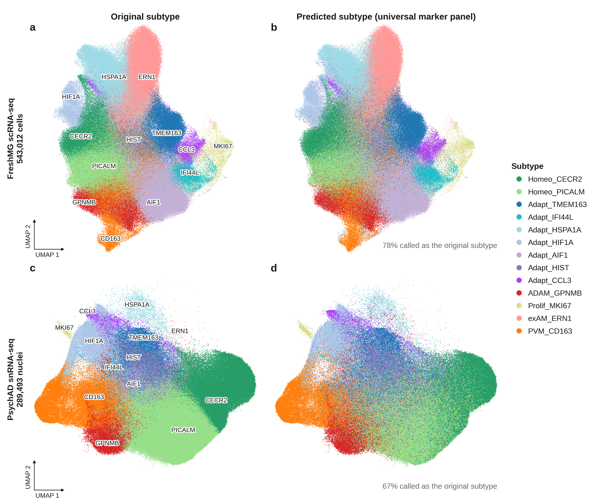

# Annotation of 13 myeloid subtypes with 100 weighted markers

`annotate_myeloid_subtypes` assigns each microglia or perivascular macrophage to one of the 13 subtypes of the
taxonomy, using 100 weighted marker genes per subtype (1,109 genes in total). One set of weights is used for
both cells (scRNA-seq) and nuclei (snRNA-seq).

## Usage

```python
import annotate_myeloid_subtypes

# adata: myeloid cells only, raw counts
# adata = adata[adata.obs["subclass"] == "Micro_PVM"].copy()
annotate_myeloid_subtypes(adata, weights='weighted_markers_top100.csv', batch='Source')
```

`adata` is modified in place:

| Added | Content |
|---|---|
| `adata.obs['pred_subtype']` | predicted subtype (13 categories) |
| `adata.obs['pred_subclass']` | Homeo, Adapt, ADAM, Prolif, exAM or PVM |
| `adata.obs['pred_prob']` | probability of the predicted subtype |
| `adata.obsm['pred_log_prob']` | log-probability of each of the 13 subtypes (cells x subtypes) |

Requirements and options:

- **Input**: myeloid cells or nuclei only, from one technology, with raw counts of all genes in
  `adata.layers['counts']`, `adata.raw` or `adata.X` (or name the layer with `layer=`).
- **Genes** are matched by Ensembl ID when `adata.var` has them (index, or a column named `gene_id`, `gene_ids`,
  `featureid` or `ensembl_id`), otherwise by symbol.
- **`batch`**: column of `adata.obs` naming the batch (brain bank, site, chemistry). Every gene is centred and
  scaled within each batch, so each batch should hold a mix of myeloid states. Without `batch`, genes are
  scaled over all of `adata`.
- **Dependencies**: anndata, numpy, pandas, scipy.

## Files

| File | Content |
|---|---|
| `annotate_myeloid_subtypes.py` | the function |
| `weighted_markers_top100.csv` | weights fitted on all donors: first row intercepts, then one row per gene and one column per subtype |
| `prioritised_markers_top100.csv` | the 100 markers of each subtype in order of priority, with the weight of each marker for its own subtype |

Columns of `prioritised_markers_top100.csv`:

| Column | Meaning |
|---|---|
| `rank` | priority within the subtype |
| `weight` | weight of the gene for this subtype in `weighted_markers_top100.csv` |
| `recurrence`, `n_donor_groups` | donor groups in which the gene marks the subtype (FDR <= 0.05, fold change >= 2), out of those tested |
| `auroc`, `fold_change`, `detection_rate` | subtype against all other myeloid cells, averaged over donor groups |
| `n_lists` | number of subtypes that list the gene |

## How the markers and weights were derived

- **Reference data**: FreshMG scRNA-seq (543,012 cells) and PsychAD snRNA-seq (289,493 nuclei), each split
  into 5 donor groups.
- **Clear cells**: a cell or nucleus is clear when at least 80% of its 30 nearest neighbours carry the same
  subtype label (62% of cells, 13% of nuclei), and boundary when fewer than half do.
- **Markers**: within each donor group, each subtype was compared with all other myeloid cells, using clear
  cells and clear nuclei only. Genes were ranked by the number of donor groups in which they mark the subtype,
  then by AUROC, and the top 100 per subtype were kept.
- **Weights**: multinomial logistic regression on log1p(CPM), centred and scaled within donor group, fitted on
  cells and nuclei together. Boundary cells were left out, and every subtype was given equal weight.
- **exAM_ERN1** arises from ex vivo activation during dissociation of fresh tissue, so it is learned from
  cells only.

## Original versus predicted subtype

The released weights applied to the two reference datasets, with genes scaled within brain bank. The weights
were fitted on these donors, so the agreement shown here (78% of cells, 67% of nuclei) is in-sample; see the
held-out results below.





## Performance on held-out donors

Markers and weights were refitted five times, each time without one donor group of cells and one of nuclei,
and the held-out donors were then annotated.

| | All | Clear | Share that is clear |
|---|---|---|---|
| Cells (FreshMG) | 74.7% | 88.2% | 62% |
| Nuclei (PsychAD) | 66.0% | 95.0% | 13% |

Recall and precision by subtype (%):

| Subtype | Cells: recall, all | Cells: recall, clear | Cells: precision | Nuclei: recall, all | Nuclei: recall, clear | Nuclei: precision |
|---|---|---|---|---|---|---|
| Homeo_CECR2 | 77 | 90 | 70 | 65 | 92 | 76 |
| Homeo_PICALM | 66 | 78 | 76 | 65 | 90 | 76 |
| Adapt_TMEM163 | 78 | 89 | 71 | 72 | 99 | 46 |
| Adapt_IFI44L | 75 | 89 | 66 | 52 | 100 | 31 |
| Adapt_HSPA1A | 78 | 93 | 84 | 69 | 93 | 46 |
| Adapt_HIF1A | 68 | 82 | 73 | 83 | 98 | 70 |
| Adapt_AIF1 | 82 | 91 | 75 | 31 | – | 27 |
| Adapt_HIST | 72 | 90 | 54 | 66 | 99 | 56 |
| Adapt_CCL3 | 75 | 87 | 58 | 60 | 98 | 44 |
| ADAM_GPNMB | 71 | 89 | 64 | 71 | 98 | 61 |
| Prolif_MKI67 | 80 | 96 | 74 | 50 | 100 | 27 |
| exAM_ERN1 | 82 | 93 | 87 | – | – | – |
| PVM_CD163 | 62 | 88 | 69 | 69 | 98 | 81 |

- **Clear cells and nuclei are recalled well**; most errors are at the boundaries between subtypes, where half
  of all nuclei sit.
- **Adapt_AIF1 is not reliable in nuclei**: it has no clear nuclei, and its markers are abundant cytosolic
  transcripts.
- **exAM_ERN1 in nuclei**: nuclei labelled exAM_ERN1 were left out of the nucleus results; about 1% of nuclei
  are predicted as exAM_ERN1.
- **`pred_prob` as a filter**: predictions with `pred_prob >= 0.8` cover 58% of cells at 90% agreement and 47%
  of nuclei at 84%.
- **Use `batch` for pooled data**: scaling all PsychAD nuclei together gives 62% agreement with the released
  weights, against 67% when scaled within brain bank.
